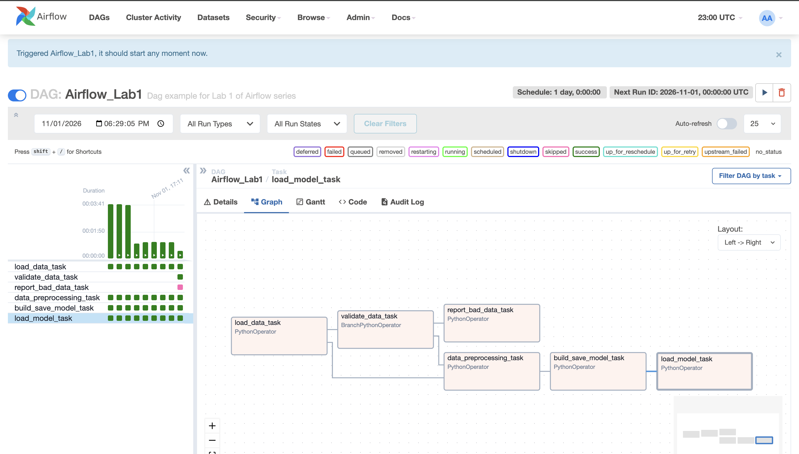

# Airflow Lab 1: K-Means Clustering Pipeline with Data Validation

An Airflow DAG, run in Docker, that loads data, validates it, trains a K-Means model, and finds the optimal number of clusters with the elbow method.

## What I changed

The original lab ran four tasks in a straight line. I added a **data validation step** using a `BranchPythonOperator`:

```
load_data → validate_data ─┬─(pass)→ data_preprocessing → build_save_model → load_model_elbow
                           └─(fail)→ report_bad_data
```

- `validate_data` checks that the required columns exist, there are at least 100 rows, and no column has more than 5% missing values.
- If the checks pass, the pipeline continues to training. If they fail, training is skipped and `report_bad_data` writes `working_data/validation_report.json`.
- Updated the `PythonOperator` import for Airflow 2.


## Setup

From this folder:

```bash
mkdir -p ./logs ./plugins ./config ./working_data ./dags/model
echo -e "AIRFLOW_UID=$(id -u)" > .env     # Windows: put AIRFLOW_UID=50000 in .env
docker compose up airflow-init
docker compose up
```

Wait for the `airflow-webserver` health check line in the terminal, then open http://localhost:8080 and log in with `airflow2` / `airflow2`.

## Running the pipeline

1. Unpause `Airflow_Lab1` and click **Trigger DAG**.
2. Open the **Graph** tab to watch the tasks run.
3. To stop Airflow: `docker compose down`

## Successful run

**Validation passes:** all main tasks are green and `report_bad_data_task` is skipped. The `load_model_task` log shows the optimal number of clusters.


